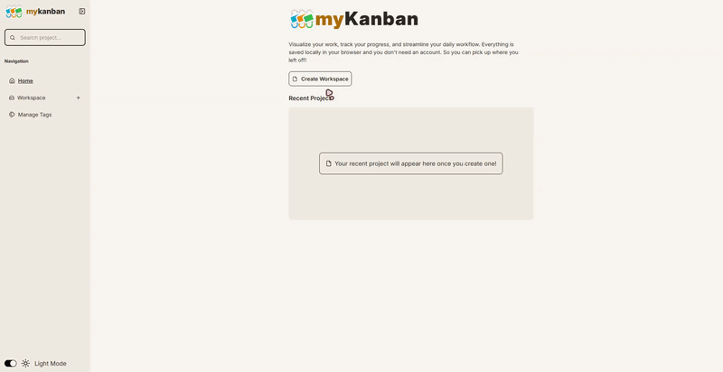
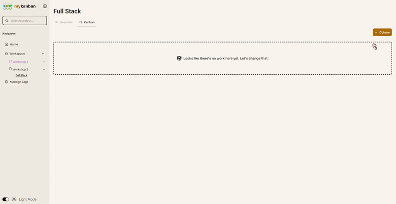
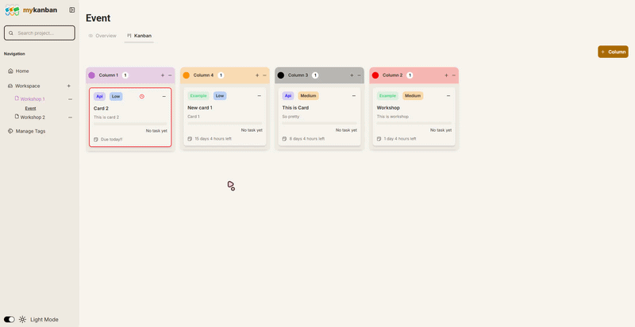
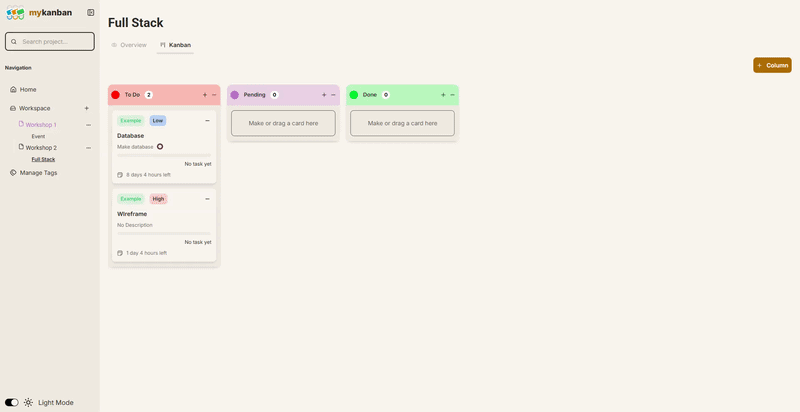
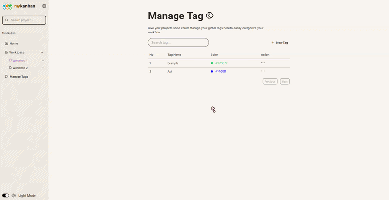
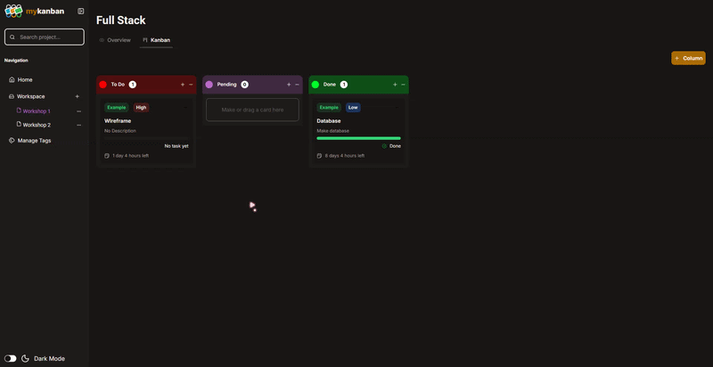

# myKanban App

[Live Demo](https://my-kanban-brown.vercel.app/)

##### Content
- About
- Tech Stack
- Key Feature
- Developer Challenge
- Gif feature Sneak peak
- How to clone the repo
### About the app
myKanban is a lightweight productivity tool designed to help users manage their workflow and organize tasks into clear, manageable categories. It requires no account creation and saves all data locally on the user's device.

### Tech Stack
- **React** - Frontend framework
- **Dexie.Js** - Wrapper for indexedDB storage
- **Tailwind CSS** - Styling
- **React Router** - Routing
- **shacnd/ui** - Component UI
- **Lucide React** - Icons
- **DnD Kit** - Drag and Drop 
- **Zustand** - Global state management
- **Date-fns** - Date display and format
- **Yup** - Validator
- **React Hook Form** - Form
- **React Colorful** - Color picker

### Key Feature
- **Local-first storage** : Using IndexedDB to store user data via [Dexie.js](https://dexie.org/), without needing a backend.
- **Drag and Drop**: Seamless card movement across the board, and draggable column using [DnD Kit](https://dndkit.com/)
- **Custom workspace/collection**: Organize your work to different categories
- **Task and Date Tracking**: Track your task progress inside your card with visible progress bar and show the remaining days left on the card display before your deadline ended
- **Deadline Warning**: The app will show you a bordered red card to let you know that your progress nearing a deadline

### Challenge & Lessons
##### Handling Drag and Drop Architecture
* **Challenge**: Implement fluid drag and drop for both column and it's nested card.
* **Solution** : Group each card data from database based on their `columnId` property. Then map both column and card data to local react state allowing the UI to recalculate and render the change during drag event.

##### Handling Creation and Data Integrity
* **Challenge**: Implement a global modal system to create workspace, column, card and task without messy prop drilling or losing track of parent-child relationship
* **Solution** : Make a centralized modal management using `Zustand` by passing resource context string and unique parent ID parameter, the modal will accurately show user input to its corresponding component and parent database record 

##### Handling Date and Time Remaining
* **Challenge**: The card need to display their remaining days or hours before the deadline ended and safely trigger style change to remind the user
* **Solution** : Make a custom utility helper using `date-fns` library with their `IntervalDuration` helper and `formatDuration`, then return their corresponding feedback 

### Demo

##### Creating your workshop collections and project

##### Creating Card and Board

##### Draggable Card and Board

##### Track your task progress

##### Manage and add your tag

##### Dark and Light mode

## Installation